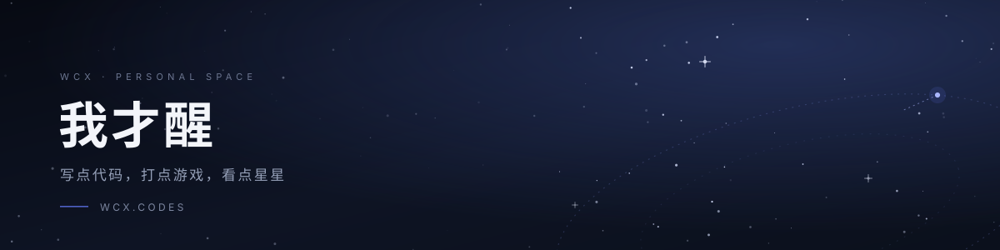

<picture>
  <source media="(prefers-color-scheme: dark)" srcset="https://raw.githubusercontent.com/wcx684/wcx684/main/assets/banner-dark.svg">
  <source media="(prefers-color-scheme: light)" srcset="https://raw.githubusercontent.com/wcx684/wcx684/main/assets/banner-light.svg">
  
</picture>

  
  
  

## 关于

软件工程在读学生

- 🛰 喜欢科幻、独立游戏，以及一切「看起来没什么用但很好玩」的东西
- ✍️ 在 [wcx.codes](https://wcx.codes) 写随笔、科幻短篇和游戏推荐，随缘更新

## 最近在折腾

| 项目 | 简介 |
| :-- | :-- |
| [**wcx.codes**](https://wcx.codes) | 随机更新一些我感兴趣的东西 |

## 

> 旅行者的旅途仍在继续。

---

  © 2026 我才醒 · <a href="https://wcx.codes">wcx.codes</a>

